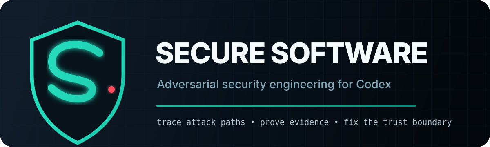

<p align="center">
  
</p>

<p align="center">
  <a href="https://github.com/GofMan5/secure-software/actions/workflows/validate.yml"></a>
  <a href="LICENSE-MIT"></a>
  <a href="https://github.com/GofMan5/secure-software/stargazers"></a>
  <a href="https://github.com/GofMan5/secure-software/releases"></a>
</p>

<p align="center">
  <strong>An adversarial security-engineering plugin for Codex.</strong><br>
  Find reachable attack chains, prove them with evidence, and fix the shared trust boundary.
</p>

<p align="center">
  <a href="docs/README.ru.md">Русская версия</a> ·
  <a href="#install">Install</a> ·
  <a href="#what-it-does">Capabilities</a> ·
  <a href="docs/EVALUATION.md">Evaluation</a> ·
  <a href="ROADMAP.md">Roadmap</a> ·
  <a href="SECURITY.md">Security policy</a>
</p>

## Why Secure Software

Most security reviews stop at suspicious syntax, scanner labels, or generic checklists. Secure Software is built around a stricter proof model:

```text
attacker entry -> controlled data or identity -> security control
-> bypass primitive -> privileged sink -> impact or persistence
```

A candidate is not promoted into a finding until the essential chain is reachable and supported by code, configuration, dependency, or runtime evidence. Counterevidence and proof gaps stay visible.

## What it does

| Capability | What you get |
| --- | --- |
| Threat modeling | Assets, principals, trust boundaries, privileged sinks, and high-impact attack hypotheses. |
| Repository security audits | Focused, standard, or independent multi-pass review through Codex Security executors when installed. |
| Attack-path validation | Source-to-sink proof, sibling bypass search, exploit prerequisites, blast radius, and calibrated confidence. |
| Reverse engineering | Binary, protocol, IPC, update-chain, local trust-boundary, and exploit-primitive analysis. |
| Platform coverage | Web/API, desktop/mobile, cloud/IAM, CI/CD, containers, Kubernetes, OS, databases, games, firmware, IoT, and OT/ICS. |
| Current intelligence | MITRE ATT&CK Enterprise/Mobile/ICS and CISA KEV snapshots, plus bounded vendor/CVE/OSV/EPSS/Snyk enrichment. |
| Root remediation | The smallest complete fix at the shared enforcement boundary, with malicious and legitimate regression checks. |

The skill is capability-first: it supports deep reverse, exploit-chain, binary, protocol, and adversarial analysis. Real external effects still follow the resolved target and execution contract.

## Install

### Codex plugin marketplace

```bash
codex plugin marketplace add GofMan5/secure-software
codex plugin add secure-software@secure-software
```

Start a new Codex session after installation, then invoke the skill explicitly:

```text
$secure-software threat-model this repository and trace the highest-impact attack paths
```

### Direct skill install

Ask Codex:

```text
$skill-installer install https://github.com/GofMan5/secure-software/tree/main/plugins/secure-software/skills/secure-software
```

### Repository-scoped use

Copy `plugins/secure-software/skills/secure-software` into:

```text
<repo>/.agents/skills/secure-software
```

## Example prompts

```text
$secure-software run a deep repository-wide security audit; prove complete attack paths and rank only validated findings
```

```text
$secure-software reverse this desktop application's IPC and updater trust boundaries, then identify realistic privilege chains
```

```text
$secure-software correlate this SBOM and deployed configuration with vendor advisories, OSV, KEV, and EPSS; prove reachability before reporting
```

```text
$secure-software fix the validated tenant-escape finding at the narrowest shared authorization boundary and add one regression check
```

## Evidence contract

Every reportable finding includes:

- severity and confidence as separate judgments;
- exact evidence and the complete entry-to-impact chain;
- attacker prerequisites, affected assets, tenants, and blast radius;
- counterevidence, assumptions, environmental dependencies, and proof gaps;
- root cause, minimum complete remediation, and a verification strategy.

Candidates contradicted by evidence are suppressed. Missing attack edges are deferred instead of being presented as vulnerabilities.

## Threat intelligence

The bundled standard-library fetcher creates a provenance-rich snapshot of active MITRE ATT&CK techniques and the complete CISA Known Exploited Vulnerabilities catalog:

```bash
python plugins/secure-software/skills/secure-software/scripts/fetch_threat_intel.py \
  --output threat-intel.json
```

It validates HTTPS origins, redirects, catalog versions, STIX identities, ATT&CK relationships, KEV schema and freshness, resource limits, and atomic output behavior. Intelligence matches are leads, not automatic findings.

## Package layout

```text
.agents/plugins/marketplace.json
plugins/secure-software/
├── .codex-plugin/plugin.json
├── assets/
└── skills/secure-software/
    ├── SKILL.md
    ├── agents/openai.yaml
    ├── references/
    └── scripts/fetch_threat_intel.py
```

## Validation

```bash
python scripts/validate_repo.py
python plugins/secure-software/skills/secure-software/scripts/fetch_threat_intel.py --self-test
python scripts/package_plugin.py
```

The release gate checks the plugin and marketplace manifests, exact skill tree, frontmatter, relative links, bidirectional Unicode controls, test-case inventory, offline threat-intelligence regressions, and the submission ZIP layout.

See [the evaluation report](docs/EVALUATION.md) for verified scope, blind forward tests, residual limits, and the distinction between design quality and measured outcomes.

The highest-leverage next work is tracked in [ROADMAP.md](ROADMAP.md): a held-out A/B benchmark, normalized evidence adapters, a dedicated reverse/binary/protocol runbook, dependency-to-deployment correlation, and a machine-readable runtime/IAM ledger.

## Contributing

Security boundaries deserve focused changes and reproducible evidence. Read [CONTRIBUTING.md](CONTRIBUTING.md) before opening a pull request. Report sensitive vulnerabilities through [SECURITY.md](SECURITY.md), not a public issue.

## License

Licensed at your option under either:

- [Apache License 2.0](LICENSE-APACHE), or
- [MIT License](LICENSE-MIT).

Unless you explicitly state otherwise, contributions are licensed under the same terms. See [NOTICE](NOTICE) for third-party names, data sources, and attribution notes.

---

No security workflow can prove that arbitrary future software is unhackable. Secure Software is designed to make scope, evidence quality, unverified surfaces, and residual risk explicit.
